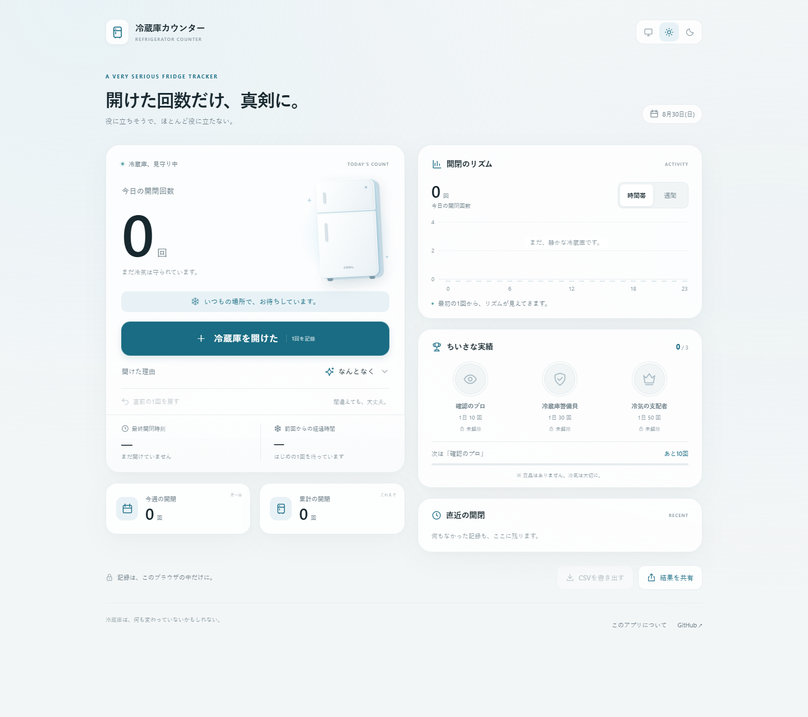
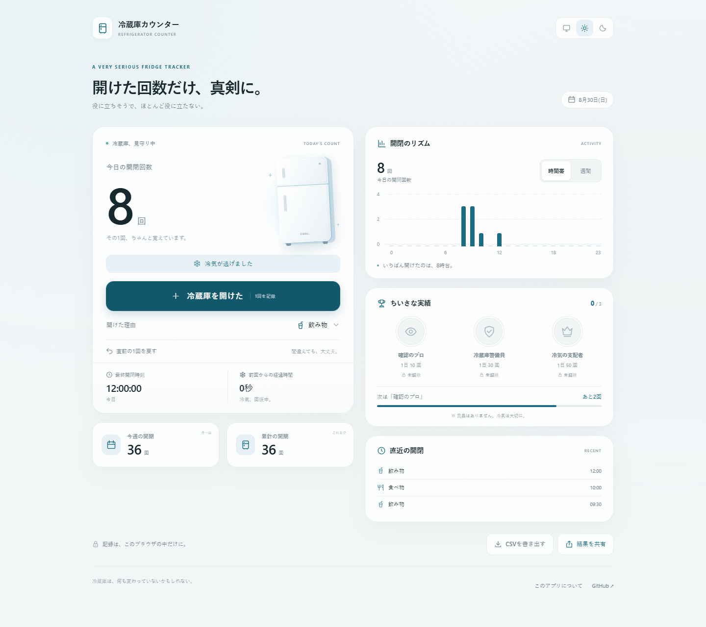
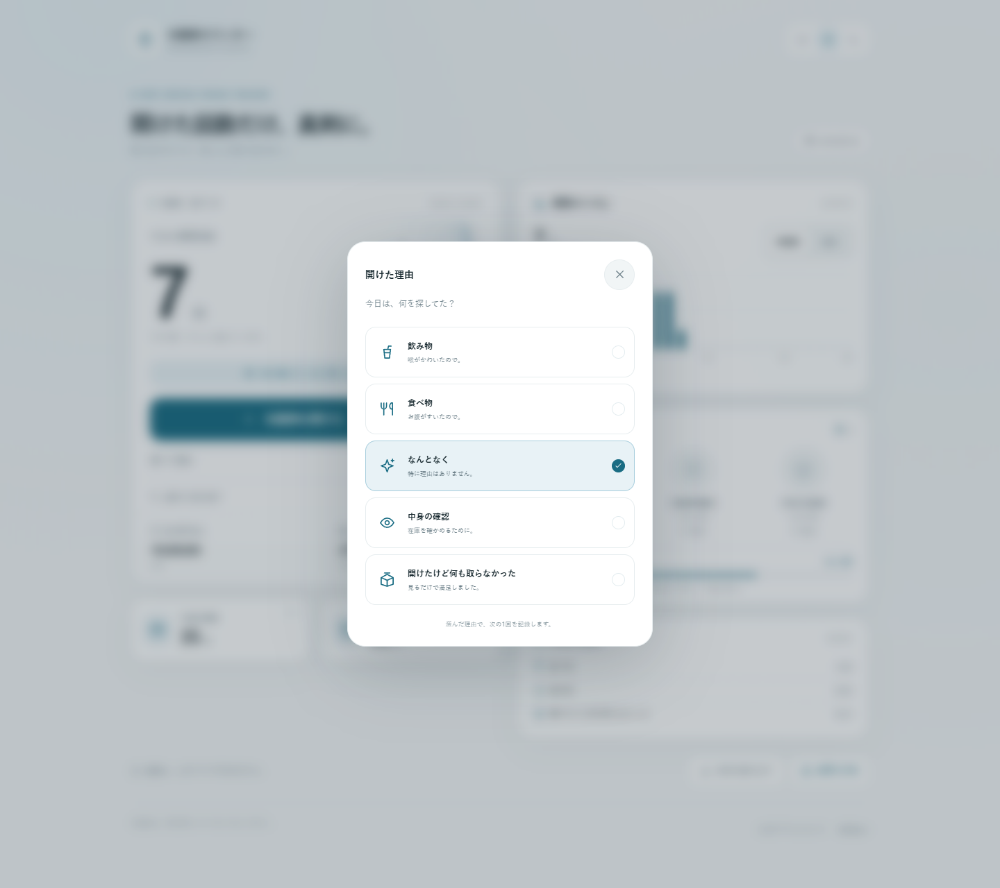
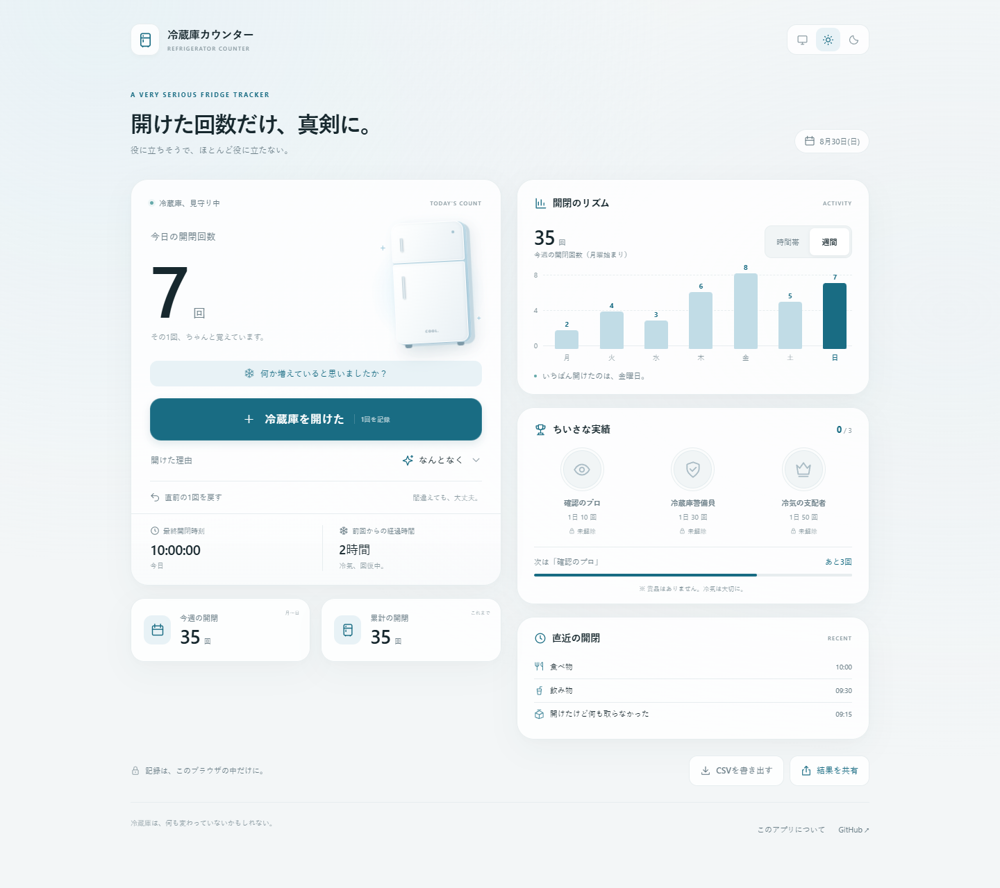
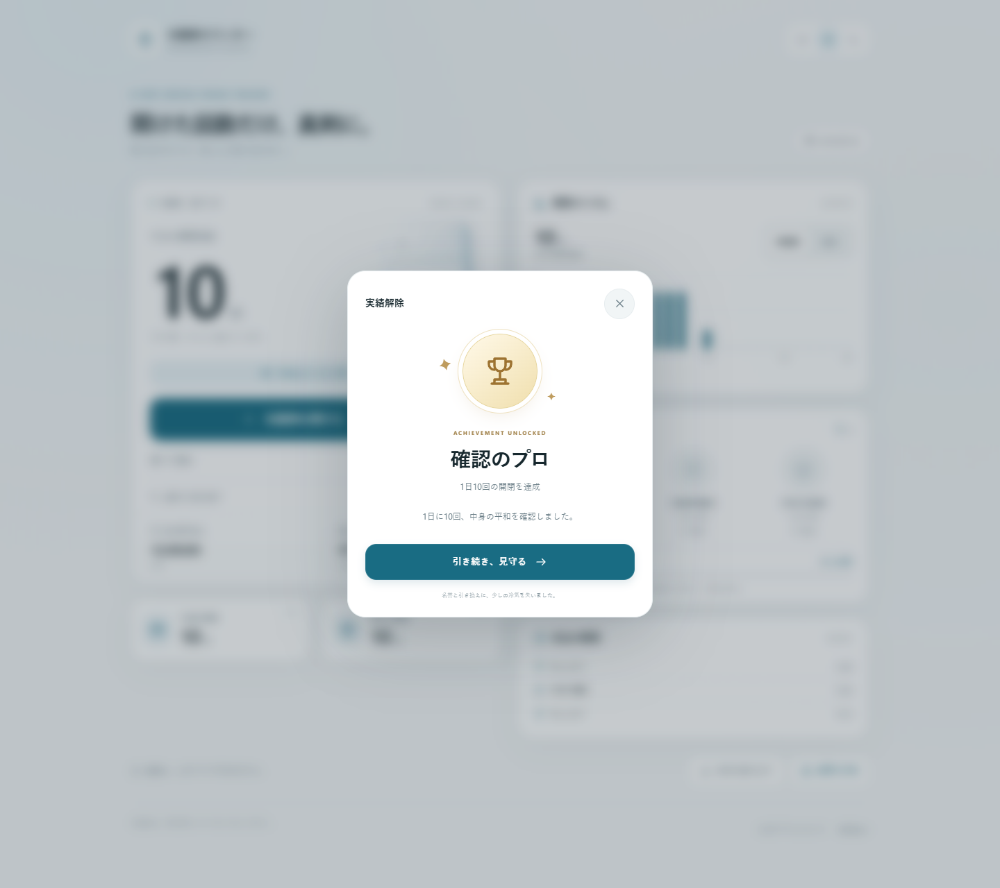

# 冷蔵庫カウンター

開けた回数だけ、真剣に。

冷蔵庫を開けた回数だけを記録する、役に立ちそうでほとんど役に立たない Web アプリです。大きなボタンを押すと、冷蔵庫の扉が少し開き、記録と一緒にちょっと余計なひと言が残ります。

食品の在庫管理も、献立の提案も、実際の冷蔵庫との連携もありません。数えるのは、あなたがボタンを押した回数だけです。

- 公開アプリ：[refrigerator-counter.vercel.app](https://refrigerator-counter.vercel.app)
- GitHub 公開リポジトリ：[shunsoco-stack/refrigerator-counter](https://github.com/shunsoco-stack/refrigerator-counter)
- [検証手順・実施記録](docs/verification.md) / [掲載用紹介文](docs/publish-copy.md)

## できること

- 中央の「冷蔵庫を開けた」ボタンで 1 回を記録
- 「飲み物」「食べ物」「なんとなく」「中身の確認」「開けたけど何も取らなかった」の 5 種類から理由を選択
- 今日・今週・累計の回数、最終開閉時刻、前回からの経過時間を表示
- 今日の時間帯別グラフと、月曜始まりの週間グラフを切り替え
- 「中身はさっきと同じです」「何か増えていると思いましたか？」「冷気が逃げました」を順番に表示
- 1 日の開閉回数に応じた実績解除、直前の記録を 1 回だけ取り消し
- CSV エクスポート、結果の共有、最近の記録の表示
- ライト・ダーク・システム設定に対応した、白と半透明を基調にしたモバイルファースト UI
- PWA としてのインストール、初回オンライン読み込み後のオフライン利用

扉にはスプリングアニメーションを使用し、動きを減らす OS 設定を尊重します。理由選択にはネイティブのダイアログを用い、グラフには読み上げ用の数値も用意しています。

## スクリーンショット

2026 年 8 月 27 日、公開アプリを Playwright で操作して取得した 5 枚です（1440 × 1280px）。撮影では日時を 2026 年 8 月 30 日 12:00（日本時間）に固定し、撮影専用の模擬記録を使用しています。実利用者の記録や利用実績を示すものではありません。対象 URL・検証結果は[検証記録](docs/verification.md)にまとめています。

### 1. 初期画面



### 2. 開閉回数が増えた画面



### 3. 理由選択画面



### 4. 週間グラフ



### 5. 実績解除画面



## 使い方と記録のルール

1. 必要に応じて理由を選びます。初期値は「なんとなく」です。
2. 冷蔵庫を開けたら「冷蔵庫を開けた」を 1 回押します。選択中の理由と現在時刻を保存します。
3. 押し間違えたときは「1 回戻す」を使います。新しく記録するまでは、続けて古い記録を取り消せません。

理由の変更は次の記録から適用され、過去の記録は書き換えません。取り消せる直前の 1 件は再読み込み後も保持されます。取り消しても、すでに解除した実績は残ります。

| 1 日の回数 | 解除する実績 |
| --- | --- |
| 10 回 | 確認のプロ |
| 30 回 | 冷蔵庫警備員 |
| 50 回 | 冷気の支配者 |

実績の条件は累計ではなく、同じ日に記録した回数です。一度解除した実績は翌日以降も残り、同じ実績を繰り返し解除することはありません。

### 日付と集計

- 日付・時刻・時間帯の表示と集計には、閲覧している端末のローカルタイムゾーンを使います。
- 「今日」は現地時刻の 0 時から翌日 0 時まで、「今週」は月曜から日曜までです。週の区切りは固定の 168 時間ではなく、カレンダー日付で計算します。
- 保存する時刻は ISO 8601 形式です。タイムゾーンを変更すると、表示時刻や日別・時間帯別の集計が変わる場合があります。
- 日付が変わると今日・今週の表示を更新します。過去の記録や累計は消去しません。最終開閉時刻は全記録のうち最新の時刻です。
- 経過時間はおよそ 1 秒ごとに更新し、タブに戻ったときも更新します。端末時計を戻した場合の負の経過時間は 0 として扱います。

### 保存先・CSV・共有

| localStorage のキー | 内容 |
| --- | --- |
| `refrigerator-counter:v1` | バージョン付きの全記録、解除済み実績、直前の Undo 対象、選択中の理由 |
| `refrigerator-counter:theme` | `system` / `light` / `dark` のテーマ設定 |

記録にアカウントやサーバーデータベースは使いません。同じオリジンの別タブには変更が反映されますが、異なる端末・ブラウザ・公開 URL 間での同期やバックアップ機能はありません。Web Locks API 対応ブラウザでは、複数タブからの同時保存も順番に処理して記録の上書きを防ぎます。非対応の古いブラウザでは 1 タブでの利用を推奨します。

ブラウザのサイトデータ削除、保存容量の制限、プライベートブラウジングなどで記録が失われたり保存できなかったりする場合があります。保存に失敗した操作は成功扱いにしません。不正な保存データを検出した場合も、元データを自動で上書きせずエラーを表示します。

CSV は全記録を時刻順に出力し、日本語ヘッダー・UTF-8 BOM・CRLF 改行を使用します。記録 ID、ISO 8601 の日時、ローカルの日付・時刻、理由を含み、表計算ソフトで数式と解釈され得るセルの対策も行っています。CSV インポートやアプリ内への復元は未対応です。

共有は、対応ブラウザでは OS の共有画面、それ以外ではクリップボードへのコピーを使います。コピーも使えない場合は、手動で選択・コピーできるテキストを表示します。共有するのは今日・今週・累計の回数と紹介文、公開 URL です。操作をキャンセルしても記録は変わりません。

## 技術構成

| 項目 | 使用技術 |
| --- | --- |
| ランタイム | Node.js 24.x |
| アプリ | Next.js 16.3.3 / App Router / React 19.2 |
| 言語・スタイル | TypeScript / Tailwind CSS 4 / CSS |
| モーション | Motion 13 |
| 保存 | localStorage / `useSyncExternalStore` |
| テスト | Vitest / Playwright / ESLint / TypeScript |
| 計測 | Vercel Web Analytics |
| PWA | Web App Manifest / Service Worker |
| 公開先 | Vercel / GitHub 公開リポジトリ |

コア機能に外部の有料 API、API キー、データベースは必要ありません。

## ローカル開発

Node.js 24.x と npm を用意し、プロジェクトのディレクトリで実行します。

```sh
npm ci
npm run dev
```

開発画面は `http://localhost:3000` です。通常のローカル利用に `.env` の設定は不要です。公開先を変更する場合は [src/lib/site.ts](src/lib/site.ts) の `SITE_URL` と `GITHUB_URL` を実際の値に合わせてください。共有 URL・メタデータ・サイトマップなどがこの設定を参照します。

| コマンド | 用途 |
| --- | --- |
| `npm ci` | ロックファイルに従って依存関係をインストール |
| `npm run dev` | 開発サーバー |
| `npm run lint` | ESLint |
| `npm run typecheck` | Next.js の型生成と TypeScript の検査 |
| `npm run test` | 集計・保存形式・Undo・実績・CSV などの単体テスト |
| `npm run build` | 本番ビルド |
| `npm run start` | ビルド済みアプリの本番サーバー |
| `npm run test:e2e` | Playwright によるブラウザテスト |
| `npm run assets` | アイコン・favicon・OG 画像の再生成 |
| `npm run screenshots` | 公開アプリの掲載用スクリーンショット 5 枚を取得 |
| `npm run secret:scan` | Secret Scan。対象・使用ツール・結果は検証記録に記載 |
| `npm run verify` | lint → typecheck → 単体テスト → build を順番に実行 |

ブラウザテストは `BASE_URL` を省略すると `http://127.0.0.1:3000` を対象にします。公開 URL を検証・撮影する場合は `BASE_URL` を指定します。例えば PowerShell では次のように実行します（本番公開の確認後に使用）。

```powershell
$env:BASE_URL = "https://refrigerator-counter.vercel.app"
npm run test:e2e
npm run screenshots
```

Secret Scan には Gitleaks が必要です。PATH 上の `gitleaks` を使用するか、`GITLEAKS_BIN` に実行ファイルのパスを指定してください。スキャンはファイルと Git 履歴を対象にします。ローカルの実行ファイルや認証情報はリポジトリへ含めません。

Playwright 用の Chromium がない環境では、先に次を実行してください。ダウンロードにネットワーク接続が必要です。

```sh
npx playwright install chromium
```

画像再生成はローカルの SVG / HTML と Chromium を使用し、描画時に外部へ通信しません。`npm run assets` は既存の画像資産を上書きします。元のアイコンは [public/icons/fridge.svg](public/icons/fridge.svg)、OG 画像のレイアウトは [scripts/generate-assets.mjs](scripts/generate-assets.mjs) にあります。日本語システムフォントの違いで描画結果が変わるため、同一の出力が必要な場合はブラウザとフォント環境をそろえてください。

## PWA・オフライン

manifest は `/manifest.webmanifest` で提供し、192px・512px・maskable 512px のアイコンを含みます。favicon、Apple 用アイコン、1200 × 630px の OG 画像も同梱しています。

Service Worker は本番モードの安全なコンテキストでのみ登録します。`npm run dev` では登録しません。ローカルで確認する場合は `npm run build` の後に `npm run start` を使います。

初回はオンラインでページを開き、Service Worker のインストールとキャッシュ作成が完了するまで待つ必要があります。その後は保存済みのアプリ画面をオフラインで再読み込みし、記録・集計・CSV 出力を利用できます。初めてのアクセス、キャッシュ削除後、ブラウザが保存領域を回収した後のオフライン起動はできません。

画面遷移はネットワークを優先し、通信できない場合に保存済みの画面を返します。ハッシュ付きの Next.js 静的アセットはキャッシュを優先します。RSC・API・Analytics・外部通信はオフラインキャッシュの対象外です。Service Worker は記録の localStorage に触れず、古いキャッシュの削除もこのアプリ専用の名前に限定します。

インストールの導線や表示は OS・ブラウザによって異なります。対応する Chrome / Edge ではブラウザのインストール機能、iPhone / iPad の Safari では共有メニューからの「ホーム画面に追加」などを利用します。インストールに対応しない環境でも通常の Web アプリとして使えます。ネイティブ共有、保存容量、オフライン保存期間にも環境差があり、全ブラウザでの同一動作を保証するものではありません。

## Analytics とプライバシー

Vercel Web Analytics を組み込み、ページ閲覧と主要操作の匿名の利用統計を計測する構成です。Web Analytics のデータは Vercel に送信されます。アプリの記録がローカル保存であることと、通信が一切ないことは同じではありません。[Vercel のプライバシー説明](https://vercel.com/docs/analytics/privacy-policy)

| カスタムイベント | アプリが渡すプロパティ |
| --- | --- |
| `fridge_opened` | 選択した理由の ID |
| `reason_selected` | 選択した理由の ID |
| `opening_undone` | なし |
| `csv_exported` | 出力した記録の件数 |
| `result_shared` | OS 共有 / クリップボードの方法 |
| `achievement_unlocked` | 解除条件の回数 |
| `chart_viewed` | 時間帯別 / 週間の表示種別 |
| `theme_changed` | 選択したテーマ |

アプリから全履歴・記録 ID・保存された各開閉の正確な日時をカスタムプロパティとして送ることはありません。ただし、Analytics 自体がイベントの受信時刻などを扱うこととは区別してください。通信が遮断されても、計測失敗によって記録操作を止めない設計です。

カスタムイベントは Vercel Pro / Enterprise の対象です。Hobby のページ閲覧計測と、主要操作のカスタムイベント計測は別の要件です。SDK を設置しただけではダッシュボードへの記録成功を保証できず、プロジェクト側の有効化・対象プラン・通信状況の確認が必要です。このプロジェクトのセットアップは有料プランへの変更、トライアル開始、有料アドオンの購入を自動では行いません。料金が発生する変更は所有者の明示的な判断が必要です。[公式のプラン条件](https://vercel.com/docs/analytics/limits-and-pricing)

## 検証・公開について

lint・typecheck・build、単体テスト 79 件、Playwright E2E 24 件に成功しています。E2E はローカル本番ビルドと公開 URL の両方で実施し、オフライン再読み込み、2 タブ同時記録、保存失敗からの復旧も確認済みです。Gitleaks 8.30.0 による作業ファイル・全 Git 履歴の Secret Scan は検出 0 件。詳細は[検証記録](docs/verification.md)を参照してください。

独立した `refrigerator-counter` リポジトリと Vercel プロジェクトに公開しています。Vercel は Next.js / Node.js 24.x に設定し、本番ビルド・HTTPS 公開を確認済みです。GitHub 自動デプロイ連携は現在の権限では接続できなかったため、CLI でデプロイしています。GitHub への push だけでは公開アプリは更新されません。

所有者が更新を公開する場合は、テストと Secret Scan の後、対象プロジェクトへのリンクを確認して実行します。

```sh
npx vercel link --yes --project refrigerator-counter --scope shunsoco-stacks-projects
npx vercel deploy --prod --yes --scope shunsoco-stacks-projects
```

`.vercel/`、`.env*`、ローカルのテスト結果・一時ファイルは Git とデプロイの対象外です。生成された認証情報はコミットしないでください。
